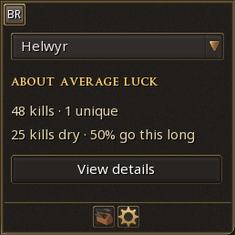
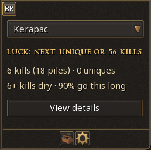
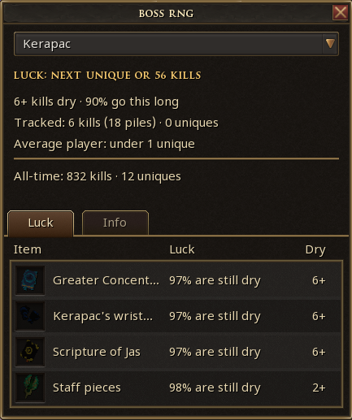
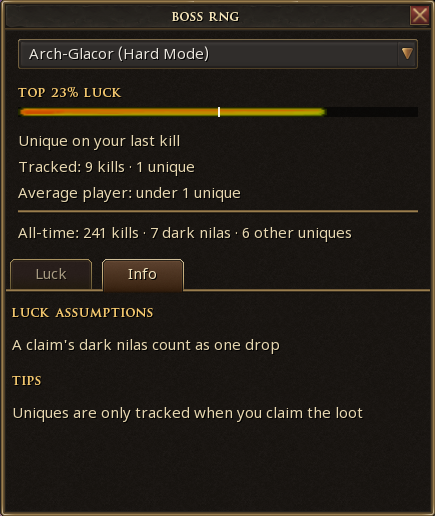
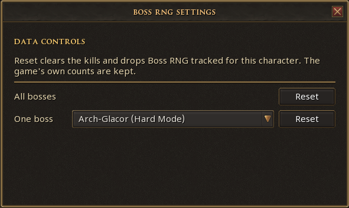

# How Boss RNG works

Boss RNG compares the uniques you got at a boss with what an average player would
have after the same kills. It never shows drop rates, only how your luck compares.

## What it counts

- **Only kills it sees.** Counting starts the day you install Boss RNG, and only
  while it's on. Kills and drops while it's off aren't counted.
- **Each kill at its own day's rates.** When Jagex changes a drop rate, kills
  before the change keep the old rate, so your past luck isn't rewritten.
- **The kill's real conditions,** where the game shows them: Croesus contribution,
  Amascut's enrage, Barrows brothers killed, Kerapac's loot piles, and so on.
  Each boss's page in [Supported bosses](../bosses/README.md) lists what it reads.
- **Uniques only:** the items on the boss's collection log page that are rare
  drops. Pets, commons and items you make from other drops aren't counted.

Your all-time kill counts and collection log counts are shown too, as the game
keeps them. They're facts for reference and never change your luck.

## The panel

The ribbon panel shows one boss: the one you picked in its dropdown, or else the
one you killed last.

| You see | It means |
|---|---|
| **Top 23% luck** | Only about 23% of players would have done as well with the same kills. |
| **About average luck** | You're in the middle 20% of players. |
| **Bottom 12% luck** | About 88% of players would have done better by now. |
| **Spooned** or **Cursed** | You're in the top or bottom 10%. |
| **Luck: next unique or 40 kills** | It's too early to rate. Luck shows once an average player would have one unique, or as soon as you get your first. |
| **12 kills dry · 4% go this long** | 12 kills since your last unique, and only 4% of players would go 12 kills without one. |
| **12+ kills dry** | The streak may be longer: you had kills before Boss RNG was tracking. |
| **212 kills · 2 uniques** | What Boss RNG has tracked for this boss. Barrows adds partial chests ("12 chests (+2 partial)") and Kerapac your loot piles ("40 kills (97 piles)"). |

**View details** opens the details window.

## The details window

The top shows the same luck and dry streak, then:

- **Tracked:** the kills and uniques Boss RNG counted, as on the panel. Some bosses
  count something other than kills: Vorkath and Barrows chests, or Amascut piles
  claimed. Barrows also shows partial chests, from runs with too few brothers for
  the game's kill count.
- **Average player:** how many uniques an average player would have.
- **All-time:** the game's kill count and collection log uniques. Stacked items
  such as Vorkath's spikes are counted on their own.

The **Luck** tab lists each unique, unluckiest first:

- **Item:** hover over the icon for its full name and the average player's drops of
  it. The number on the icon is how many you got while tracked; it's dimmed until
  you get one.
- **Luck:** as above, or "91% are still dry" before it can be rated, or "no chance
  yet" if none of your tracked kills could drop it.
- **Dry:** kills (or chests or piles, as above) since your last one of that unique.

The **Info** tab lists what Boss RNG assumes for this boss where it can't know for
sure, such as that kills were solo, and tips for playing so kills are counted.

## Resetting

Data Controls, in Boss RNG's settings (Plugin Hub, Manage tab), resets one boss or
every boss for the character you're logged in as. The game's own counts aren't
changed.

## How luck is worked out

For a mathematical description, see [Luck math](../technical/luck-math.md).
